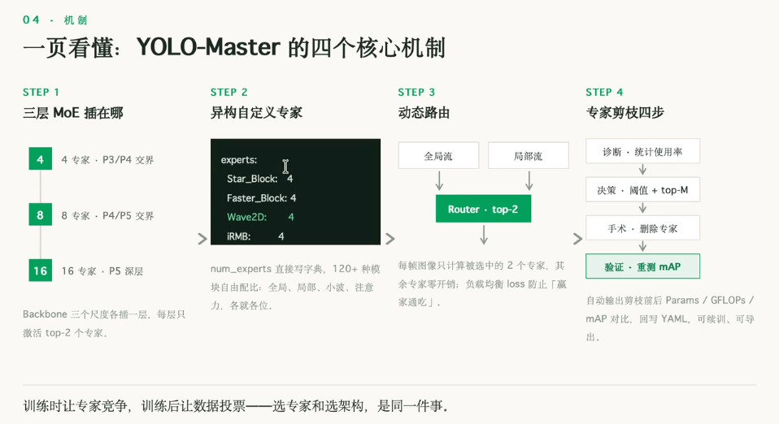

### 图图、图文
```bash
传统目标检测：
    分类头-输出分类分数
    工作流程：特征图 -> 分类头 -> softmax -> 类别概率
    特点：类别固定，需预定义类别数量
开放词汇目标检测/开集OD 图文多模态：
eg.CLIP：视觉区域 - 文本语义的对齐
    分类头-输出区域特征向量
    工作流程：区域特征向量<->Text Encoder响亮 -> 余弦相似度 -> 类别概率
    特点：通过相似度打分实现 开放类别识别
## 顶刊顶会的方向
    强调开集检测能力(Open-Vocabulary)
    依赖大规模视觉-语言预训练模型 算力要求高的！
    需大规模图文/检测/grounding数据
    在COCO、LVIS等数据集
    评估base类/ novel类/ generalized setting
## 定位为
利用"多模态"概念，用文本信息增强目标检测性能 -> 类似图图多模态利用不同模态图像信息增强检测
定位:
    Semantic Aware Closed-Vocab Detection
    Text-Enhanced Object Detection
    Language-Guided Closed- Set Object Detection
专注于利用文本语义先验提升闭集检测性能

# 现有开放词汇路线：YOLO-World/YOLOE /GroundingDINO
    目标:检测任意类别，尽可能的检测提到的类
    核心:"泛化”能力，强调Zero-shot
    工程重心: prompt工程+大规模图文对齐
    局限: 泛化强，但闭集精度未必高，对于大部分人所从事的工作来说，真的需要所谓的泛化和Zero-shot
# 图文增强闭集路线：YOLOVO
    目标: 把固定类别做得更准，视觉能力更强大
    核心: "增强"能力，强调作用表现
    工程重心: vision一text一vision双向交互闭环的底层重构
    优势: 闭集精度做深做强，同时保留一定开放能力，也可以做泛化更加符合大部分的工作场景的需要

提示词丰富的层次框架,例如：
L1基础类别 : 
    vehicle
L2颜色、纹理、形状: 
    a rectangular vehicle with metallic surface
L3尺度、空间关系、数量特征 : 
    a small rectangular vehicle, much smaller than buildings, often appearing in rows
L4场景上下文、语义关系： 
    a small vehicle parked in a parking lot or driving on a road, viewedfrom above
L5成像特性专业描述 ：
    a tiny top-down view of a vehicle in high-resolution satellite imagery,appearing as a small rectangular object with a distinct shadow, oftenclustered in parking areas or aligned along road edges

类别内细粒度拆分

漱活对齐能力：更充分激活多模态模型的跨模态对齐能力
注入领域知识：将领域先验知识以自然语言形式注入模型
无需修改结构：在不修改模型结构的前提下提升检测精度
判别性文本错点：为闭集检测提供更具判别性的文本锚点

# CVPR2026 YOLO-Master
问题：网络结构由人拍板，而非由数据决定！（不同数据集适合不同模块，可能尽管都是 全局特征提取模块）
解决：异构混合专家 + 专家剪枝闭环：网络结构由数据投票
用途：可以通过热图来解释多模态的贡献度
```


```bash
python selfcheck.py
# check passed
tri 三模态

```